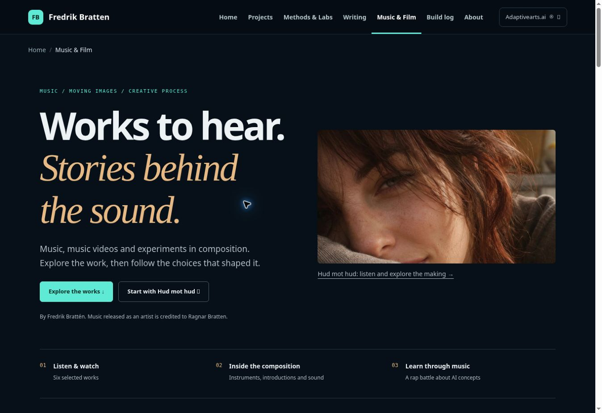
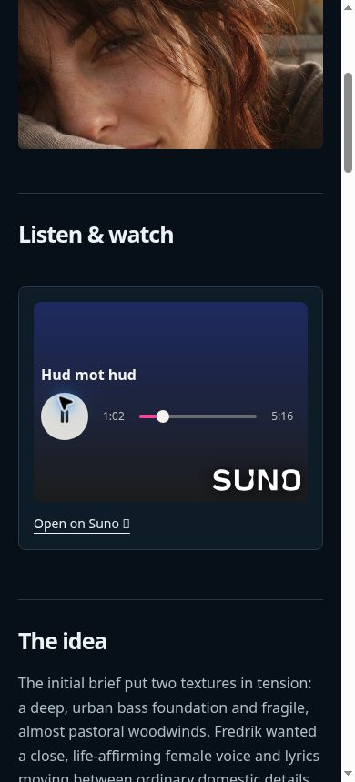

# Music & Film integration — 2026-11-12

## Scope and decision

Implement the operator's requested media-policy fix, complete the six selected
works with their existing artwork and playable music, integrate navigation, and
test desktop/mobile and actual playback. Separate branch and review PR; no merge,
deployment, account-setting changes or third-party messages are authorized here.

## Remote truth and preserved work

Branch audit: **SCOPED**. Remote heads (89 at inventory) and open PRs were checked.
Integration base: `main` at `f06d03743d1b43d748fa701f7d2d8709e23dd299`.
PR #58: `preview/muzak-music-film-20261106` at
`28cf2724b9bfccd685c09fa80fdec907ae29c0ae`, 2 ahead / 28 behind main (diverged).
Its unique four-file draft is included with a two-parent merge into the working
branch. The original `creative/preview.html` and its two source attachments retain
their bytes. There are no deletions or force updates.

Other relevant open lanes: #50 has older navigation work (3 ahead / 41 behind),
#53 has a separate Filmteam build-log change (2 ahead / 37 behind), and #64's
security change is superseded by merged #66, as its own description records.
Their unique diffs were inspected; they are not imported into this change.

## What changes

- Seven static routes: `/creative/` and six work pages. The original preview's
  detailed production narratives and teaching material are retained, with obsolete
  artwork/to-be-integrated notes removed from the production copy.
- Six original covers from the selected Suno versions, copied locally with their
  source URLs, dimensions and SHA-256 digests in the media evidence JSON.
- Eight click-to-load Suno players: six selected works plus the two educational
  examples. Two click-to-load YouTube players use `youtube-nocookie.com`.
- Original 12.63-second WAV extracted byte-for-byte from the preview; also offered
  as a same-origin download alongside the original Python source.
- Shared header/footer, breadcrumbs, all-pages directory and sitemap integration.
  Existing page bodies are unchanged; broad HTML changes are generated navigation.
- CSP explicitly admits only same-origin/data audio and the two frame origins,
  only under `creative/`. Other pages keep frames/media denied. Default deny,
  hash-authorized inline scripts, blocked script attributes and self-only connects
  remain. Provider requests begin only after a visitor clicks. External fallback
  links remain available with JavaScript disabled.

## Verification ledger

| Property | Result | Evidence / limit |
| --- | --- | --- |
| Original preview and WAV preserved | PASS | SHA-256 checks in `tests/creative_contract.py` |
| Six original cover identities | PASS | Downloaded original bytes and hashes; browser image decode is also checked in CI |
| Eight selected Suno versions play | PASS | Direct public embed UI playback; advancing `currentTime`, no media error; not full-song listening |
| Integrated Suno with release CSP | PASS | Hud mot hud played past 47 seconds under the release policy |
| Integrated WAV with release CSP | PASS | Played to end, 12.631565 seconds, no media error |
| YouTube frames admitted | PASS | Both actual players load their correct titles and durations under release CSP |
| YouTube actual playback | FAIL / OPEN | Both remain at 0:00, `readyState=0`, no media error in cloud browser. The Take ’em All control also stays at 0:00 directly on YouTube, outside our site. Cause is not established; do not claim video playback passes |
| Local source/static contracts | PASS | Creative, navigation, copy, Build Log, Harnessing, generated atlas and model contracts |
| Browser CI, built Jekyll output, mobile | PASS | Full `verify` run 43235226061 on head `325a366c07abcd380487118366c3be7cce438343`; deployment skipped |
| Manual mobile layout and Suno playback | PASS | 390 px frame, no document overflow, six covers loaded, menu opens/closes, Hud mot hud played past 25 seconds |

The deterministic frame fixture in `tests/creative_page.mjs` verifies the parent
CSP and opt-in player integration, not provider availability or video decoding.
It also checks rejected unapproved frame origins, real local WAV playback,
image decoding, all seven routes at 1365/390/320 px and no-JavaScript access.
The full existing browser suite still runs against sealed Jekyll output.

## Remaining verification and content boundary

Before calling the whole change merge-ready, resolve the YouTube playback check
and require green `verify` on the exact head. No real-phone claim is made: mobile
checks exercise narrow browser viewports. RISE Official Audio is explicitly
separate from its incomplete video pilot; unavailable pilot excerpts and unknown
version lineage are not invented or relabelled as finished work.

Next entry point: this PR's `verify` run and `docs/music-film-media-evidence-20261112.json`.

## Browser evidence and handover

[PR #69](https://github.com/fbratten/fbratten.github.io/pull/69) remains draft for
the YouTube playback gate. [Verified CI run](https://github.com/fbratten/fbratten.github.io/actions/runs/43235226061)
passed the complete static and browser suite; deployment is intentionally skipped
for a PR. This follow-up adds test evidence and a sealed preview archive; it does not alter
the site implementation. The newest PR head must also pass `verify`.





The direct YouTube control also remained buffering at 0:00, so the observed failure
is not confined to our embedded player. The provider/browser/network cause remains
unknown. A browser that can play the source YouTube video is the next entry point
for the final playback acceptance check. Do not broaden CSP further without evidence.

### Repeat the last media check outside the cloud browser

In the latest successful PR Actions run, download the
`portfolio-navigation-preview` artifact. Extract `portfolio-tested-site.zip` into
a separate folder. This contains the actual Jekyll output with release CSP,
including local covers and the original WAV. From that folder run:

```sh
python -m http.server 4173 --bind 127.0.0.1
```

Open `http://127.0.0.1:4173/creative/take-em-all/` and
`http://127.0.0.1:4173/creative/rise-together-or-we-fall/`. Load each YouTube player,
press Play, and confirm advancing playback time and sound. Record browser/version
and outcome against the exact PR head. The archive is a review aid, not deployment.
